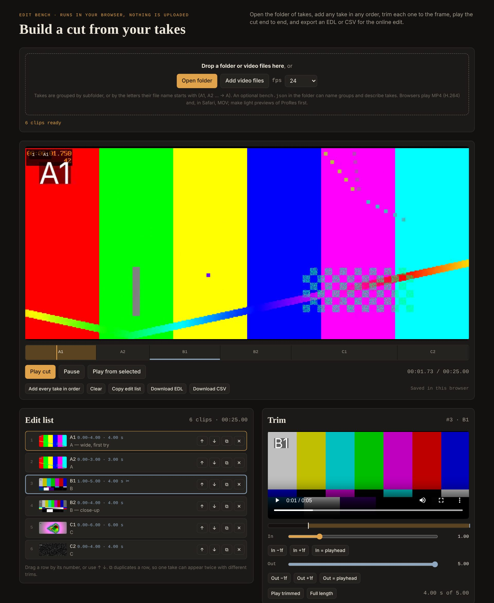

# AI film shots - Claude skills

**Website:** https://staroad-pictures.github.io/ai-film-shots-skill/ · **Edit bench:** https://staroad-pictures.github.io/ai-film-shots-skill/edit-bench/

Two Claude skills and an edit bench for making film shots with AI video.

**`ai-film-shots`** makes new or replacement shots of a film, driven from Claude:

- **Higgsfield** (Seedance 2.5): drafts, video edits, extensions, 1080p finish, 4K upscale
- **Magnific**: Seedance Pro 2.5 multi-shot, Kling 4, Aleph 2, voice isolation and cloning

and the dull but essential part around them: a continuity file to check every take against, frame sheets, ProRes 4444 masters, and rendering an edit list (CSV) into a delivered cut, one file per shot plus the joined cut.

It was written while redoing shots of a family feature film with Claude, Higgsfield and Magnific over a weekend, and collects what worked and what bit us.

## Camera look skill

**`camera-look`** turns a reference (a scene, a trailer, an ad, your own cut) into a measured "look pack" and writes Seedance 2.5 prompts in that camera language:

- `scripts/analyze_reference.py` measures the reference: cuts and shot lengths, handheld or locked, push-ins and pull-outs, pans, tilts, whips, Dutch angles, brightness and warmth, plus contact sheets of every shot.
- Claude reads the sheets for what numbers cannot give (shot sizes, lens height, staging, light sources) and fills in a look pack: house rules, principles with prompt wording, generation plans, rhythm for the edit.
- `scripts/compare_takes.py` checks generated takes against the reference.
- The prompt wording follows [our own A/B tests of Seedance 2.5](camera-look/references/seedance_camera_notes.md) (prompts and frame strips in [`tests/`](tests/camera-look-2026-10-29/)). Some findings: "dutch tilt" alone does nothing, small cants are ignored, a push-in needs a named end and a limit, more than one camera move per 4 s or so breaks the shot, and shot timings inside a take are only approximate.

## Edit bench

[`edit-bench/index.html`](edit-bench/index.html) is a one-file web page for building a cut from your takes. Open it in Chrome, Safari or Firefox. It needs no server and no install, and **nothing is uploaded**: your clips stay on your computer.

- **Open folder**, or drop video files onto the page. Takes are grouped by subfolder, or by the letters that start their file name (`A1`, `A2` go under `A`). An optional `bench.json` in the folder can name the groups and describe takes; see [`bench.example.json`](edit-bench/bench.example.json).
- Add any take, in any order. Duplicate a take to use it twice. Reorder by dragging or with the arrows.
- Trim each take to the frame (23.976, 24, 25, 29.97 or 30 fps), then play the whole cut.
- Export the cut as an **EDL** (CMX3600), a **CSV**, or a project file. The CSV feeds `scripts/render_cut.sh` straight away.
- Named versions and the current edit are saved in your browser. After a reload, open the folder again so the clips can play.

Browsers play MP4 (H.264) everywhere and MOV in Safari. For ProRes masters, make light previews first with `scripts/make_preview.sh`.

## Install

1. Set up Claude, Higgsfield and Magnific: see [`ai-film-shots/references/setup.md`](ai-film-shots/references/setup.md).
2. Zip the `ai-film-shots` folder, and the `camera-look` folder if you want it, and add each to Claude as a skill.
3. In a new chat: *"Use the ai-film-shots skill. Help me write the continuity file for my film."* Or, with a reference clip attached: *"Use the camera-look skill. Make a look pack from this clip."*

## Scripts

`ai-film-shots/scripts` need ffmpeg; `camera-look/scripts` need Python with numpy and OpenCV.

| Script | What it does |
| --- | --- |
| `scripts/contact_sheet.sh IN.mp4 [N]` | One image with N stamped frames of a take, to judge it at a glance |
| `scripts/encode_prores4444.sh IN [OUT] [--mirror] [--size WxH]` | ProRes 4444 master, optionally mirrored and conformed |
| `scripts/render_cut.sh CUT.csv MASTERS/ OUT/ [prores\|h264\|preview]` | Frame-accurate shots from an edit list, then the joined cut |
| `scripts/make_preview.sh IN.mp4 ID [DIR]` | 720 px preview and thumbnail of a take |
| `camera-look/scripts/analyze_reference.py IN.mp4 OUT/` | Cut rhythm, camera motion, cant, light and contact sheets of a reference |
| `camera-look/scripts/compare_takes.py REF/ TAKE/...` | Compares generated takes with the reference |
| `edit-bench/index.html` | The edit bench (see above) |

## Licence

MIT - see [LICENSE](LICENSE).
