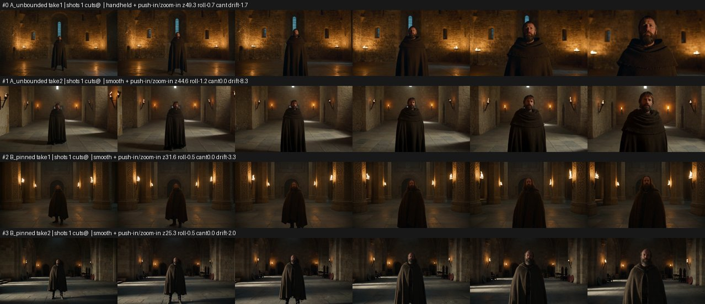
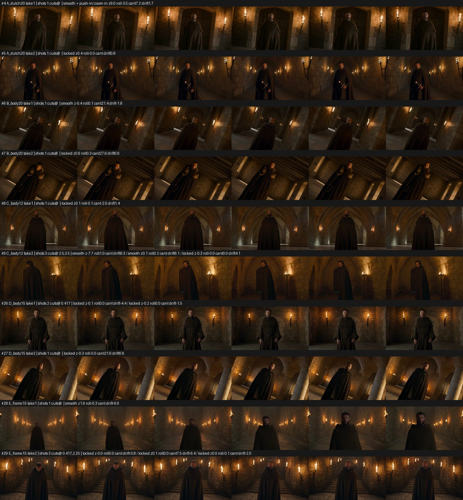
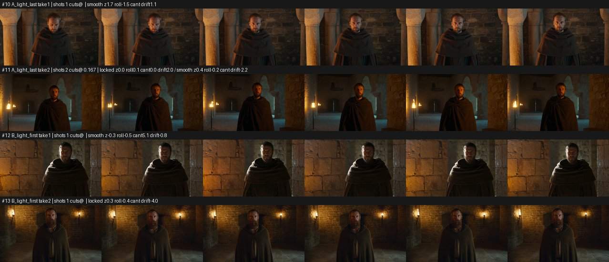
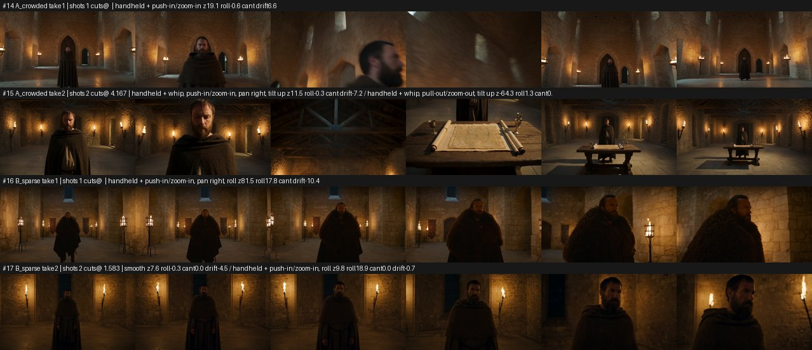
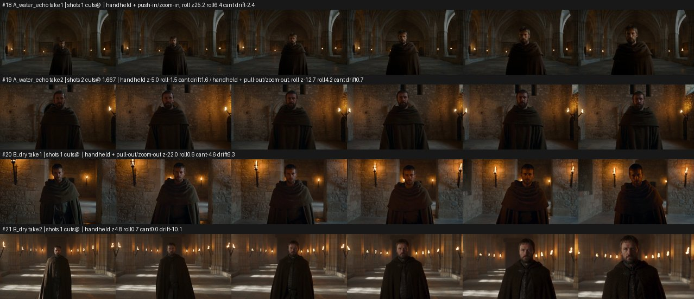
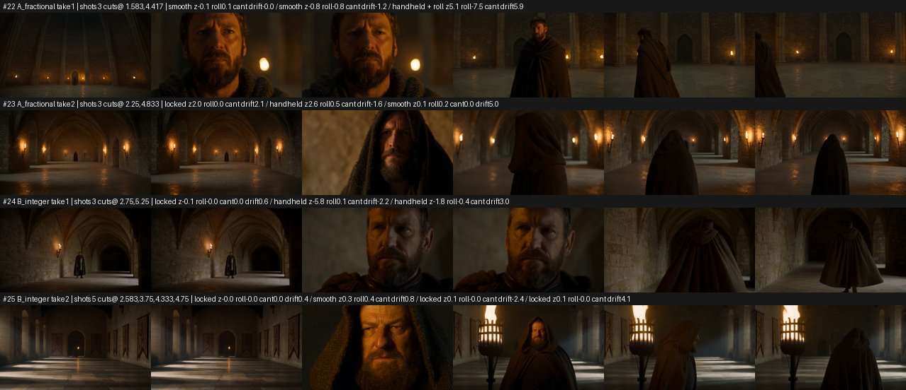

# Tests, 29 October 2026

Higgsfield `seedance_2_5`, text to video, 480p, 16:9, no reference images, 2 takes per wording. Results and the rules we drew from them: [`camera-look/references/seedance_camera_notes.md`](../../camera-look/references/seedance_camera_notes.md).

Each strip shows 6 frames from start to end of every take, with what `analyze_reference.py` measured on top (`z` = zoom %, `roll`, `cant` in degrees, `drift` = change in brightness).

## R1. Where a push-in stops



**A_unbounded** (5 s.)

```
A bearded man in his forties wearing a dark brown wool cloak, in a stone castle hall with wall torches. Period drama, 16:9, real-time speed, natural film look, one continuous take, no cuts. No music, no subtitles, no on-screen text. Warm torchlight, his face clearly exposed. Starting at full shot, head to boots, a slow handheld push-in toward the man as he looks into the distance.
```

**B_pinned** (5 s.)

```
A bearded man in his forties wearing a dark brown wool cloak, in a stone castle hall with wall torches. Period drama, 16:9, real-time speed, natural film look, one continuous take, no cuts. No music, no subtitles, no on-screen text. Warm torchlight, his face clearly exposed. Starting at full shot, head to boots, a slow handheld push-in toward the man as he looks into the distance, ending at medium shot, waist up; never closer than chest height.
```

## R2. Dutch angle wording



**A_dutch20** (5 s.)

```
A bearded man in his forties wearing a dark brown wool cloak, in a stone castle hall with wall torches. Period drama, 16:9, real-time speed, natural film look, one continuous take, no cuts. No music, no subtitles, no on-screen text. Warm torchlight, his face clearly exposed. Medium full shot, dutch tilt 20 degrees. The man stands and looks into the lens.
```

**B_body20** (5 s.)

```
A bearded man in his forties wearing a dark brown wool cloak, in a stone castle hall with wall torches. Period drama, 16:9, real-time speed, natural film look, one continuous take, no cuts. No music, no subtitles, no on-screen text. Warm torchlight, his face clearly exposed. Medium full shot. The camera body is canted about 20 degrees to the right; the roll belongs to the camera only. The man's head stays upright and he looks into the lens.
```

**C_body12** (5 s.)

```
A bearded man in his forties wearing a dark brown wool cloak, in a stone castle hall with wall torches. Period drama, 16:9, real-time speed, natural film look, one continuous take, no cuts. No music, no subtitles, no on-screen text. Warm torchlight, his face clearly exposed. Medium full shot. The camera body is canted about 12 degrees to the right; the roll belongs to the camera only. The man's head stays upright and he looks into the lens.
```

**D_body15** (5 s.)

```
A bearded man in his forties wearing a dark brown wool cloak, in a stone castle hall with wall torches. Period drama, 16:9, real-time speed, natural film look, one continuous take, no cuts. No music, no subtitles, no on-screen text. Warm torchlight, his face clearly exposed. Medium full shot. The camera body is canted about 15 degrees to the right; the roll belongs to the camera only. The man's head stays upright and he looks into the lens.
```

**E_frame15** (5 s.)

```
A bearded man in his forties wearing a dark brown wool cloak, in a stone castle hall with wall torches. Period drama, 16:9, real-time speed, natural film look, one continuous take, no cuts. No music, no subtitles, no on-screen text. Warm torchlight, his face clearly exposed. Medium full shot with a slight Dutch angle: the whole frame is rotated about 15 degrees clockwise, so the walls and floor lines run on a gentle diagonal. He looks into the lens.
```

## R3. Where the light is described



**A_light_last** (5 s.)

```
A bearded man in his forties wearing a dark brown wool cloak, in a stone castle hall with wall torches. Period drama, 16:9, real-time speed, natural film look, one continuous take, no cuts. No music, no subtitles, no on-screen text. Medium shot, handheld, the man stands still and looks at the camera. Lit by warm torchlight from the left, his face clearly exposed.
```

**B_light_first** (5 s.)

```
Light from the very first frame, constant throughout: warm torchlight from the left, his face properly exposed; the light never changes. A bearded man in his forties wearing a dark brown wool cloak, in a stone castle hall with wall torches. Period drama, 16:9, real-time speed, natural film look, one continuous take, no cuts. No music, no subtitles, no on-screen text. Medium shot, handheld, the man stands still and looks at the camera.
```

## R4. How many moves per take



**A_crowded** (8 s.)

```
A bearded man in his forties wearing a dark brown wool cloak, in a stone castle hall with wall torches. Period drama, 16:9, real-time speed, natural film look, one continuous take, no cuts. No music, no subtitles, no on-screen text. Warm torchlight, his face clearly exposed. 0-2s: handheld push-in on the man. 2-3s: orbit left. 3-4s: tilt up to the ceiling. 4-5s: whip-pan right. 5-8s: pull back to a wide shot.
```

**B_sparse** (8 s.)

```
A bearded man in his forties wearing a dark brown wool cloak, in a stone castle hall with wall torches. Period drama, 16:9, real-time speed, natural film look, one continuous take, no cuts. No music, no subtitles, no on-screen text. Warm torchlight, his face clearly exposed. 0-4s: handheld slow push-in on the man, ending at medium shot, waist up. 4-8s: slow handheld orbit left around him, ending on his three-quarter profile.
```

## R5. Water and echo words in the sound line



**A_water_echo** (5 s. Sound on.)

```
A bearded man in his forties wearing a dark brown wool cloak, in a stone castle hall with wall torches. Period drama, 16:9, real-time speed, natural film look. Medium shot, handheld, the man walks slowly toward the camera. Warm torchlight, his face clearly exposed. Audio: water dripping, echoing footsteps, waves of wind through the hall. No music, no subtitles.
```

**B_dry** (5 s. Sound on.)

```
A bearded man in his forties wearing a dark brown wool cloak, in a stone castle hall with wall torches. Period drama, 16:9, real-time speed, natural film look. Medium shot, handheld, the man walks slowly toward the camera. Warm torchlight, his face clearly exposed. Audio: footsteps on stone, torch fire crackling, room tone. No music, no subtitles.
```

## R6. Timing cuts inside a take



**A_fractional** (8 s.)

```
A bearded man in his forties wearing a dark brown wool cloak, in a stone castle hall with wall torches. Period drama, 16:9, real-time speed, natural film look. No music, no subtitles, no on-screen text. Warm torchlight, his face clearly exposed. 0-2.5s, Shot 1: wide shot of the hall, the man standing by a torch. 2.5-4.5s, Shot 2: close-up of his face. 4.5-8s, Shot 3: medium shot, he turns and walks away.
```

**B_integer** (8 s.)

```
A bearded man in his forties wearing a dark brown wool cloak, in a stone castle hall with wall torches. Period drama, 16:9, real-time speed, natural film look. No music, no subtitles, no on-screen text. Warm torchlight, his face clearly exposed. 0-3s, Shot 1: wide shot of the hall, the man standing by a torch. 3-5s, Shot 2: close-up of his face. 5-8s, Shot 3: medium shot, he turns and walks away.
```
